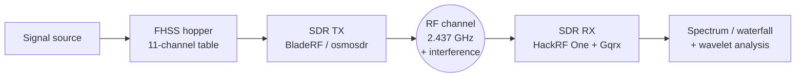
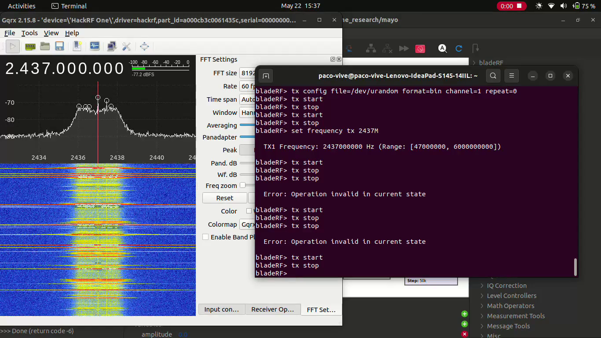
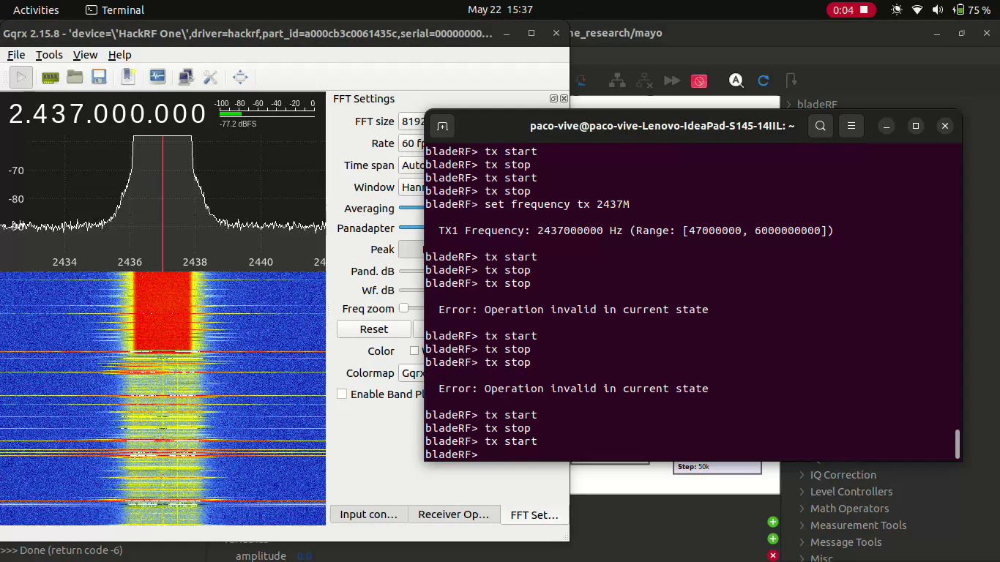

# UAV PAKAL: Secure Communication (Signal Processing & Simulation)

**PAKAL** (*Proactive Attack and Key Awareness Layer*) is a UDLAP research project on resilient UAV communication links. Drone control links are exposed to jamming, so the project studies **frequency hopping (FHSS)** as an anti-jamming technique, using SDR hardware.

This repository holds **my part of the project**: the GNU Radio flowgraphs for the FHSS simulator and the wavelet-based spectral analysis, and the over-the-air SDR tests.

- **Team:** 6 students, supervised by Dra. Zobeida Guzmán Zavaleta (UDLAP)
- **My role:** Signal Processing & Simulation Researcher (Aug 2025 – present)
- **Full project folder (Drive):** https://drive.google.com/drive/folders/11FowLxH9dFnYnMrHF18VQAB3JNu8Cf3j?usp=sharing

## System overview



## Hardware & software

| Hardware | Software |
|---|---|
| HackRF One (receiver) | GNU Radio 3.10 (GRC) |
| BladeRF (transmitter) | gr-osmosdr |
| Laptop (Ubuntu) | Gqrx 2.15 |
| | Python 3 + NumPy |

## Repository layout

```
fhss_simulator/       FHSS simulator (latest version, May 2026) + earlier mk1
  mayo.grc              flowgraph
  marzo.py              Python generated from mayo.grc
  marzo_epy_block_0.py  custom "Freq Hopper" block
  pakal_FHSS_mk1.grc/.py
wavelet_analysis/     flowgraphs with the wavelet edge-detector stage
gnuradio_flowgraphs/  development versions (pakal, pakal2, pakal3, pakalMARZO, marzo, marzo2)
  practice/             GNU Radio practice flowgraphs (Jan–Mar 2026)
gqrx/                 Gqrx receiver config (device serials removed) + band plan
media/                demo video and screenshots
```

### Custom Freq Hopper block

`fhss_simulator/marzo_epy_block_0.py` is an Embedded Python block that generates a complex carrier hopping across an **11-frequency table** centered on the tuned frequency. Parameters:

| Parameter | Default | Meaning |
|---|---|---|
| `samp_rate` | 10 MS/s | sample rate |
| `hop_rate` | 10 hops/s | hops per second |
| `hop_spacing` | 500 kHz | spacing between channels |
| `pattern` | 0 | 0 = left→right staircase, 1 = right→left, 2 = pseudo-random permutation, 3 = zigzag |

## Demo: over-the-air test

<video src="media/bladerf_tx_hackrf_rx_demo.mp4" controls width="720"></video>

[▶ Download video](media/bladerf_tx_hackrf_rx_demo.mp4) (13 s, May 22 2026)

The BladeRF transmits random data (`tx config file=/dev/urandom`) at **2437 MHz** (Wi-Fi channel 6) and is started and stopped from `bladeRF-cli`. The HackRF One with Gqrx (10 MS/s) receives it. When TX starts, the waterfall shows a wideband block of energy over the channel. When TX stops, the waterfall goes back to the noise floor.

| TX off | TX on |
|---|---|
|  |  |

## How to run

```bash
sudo apt install gnuradio gr-osmosdr gqrx-sdr
pip install -r requirements.txt

# Open and run a flowgraph in GNU Radio Companion
gnuradio-companion fhss_simulator/mayo.grc

# Or run the generated script directly (needs the epy block in the same folder)
cd fhss_simulator && python3 marzo.py
```

Flowgraphs with an `osmosdr_sink` need an SDR connected. Only transmit on bands and at power levels you are licensed for.

## License

MIT. See [LICENSE](LICENSE).
